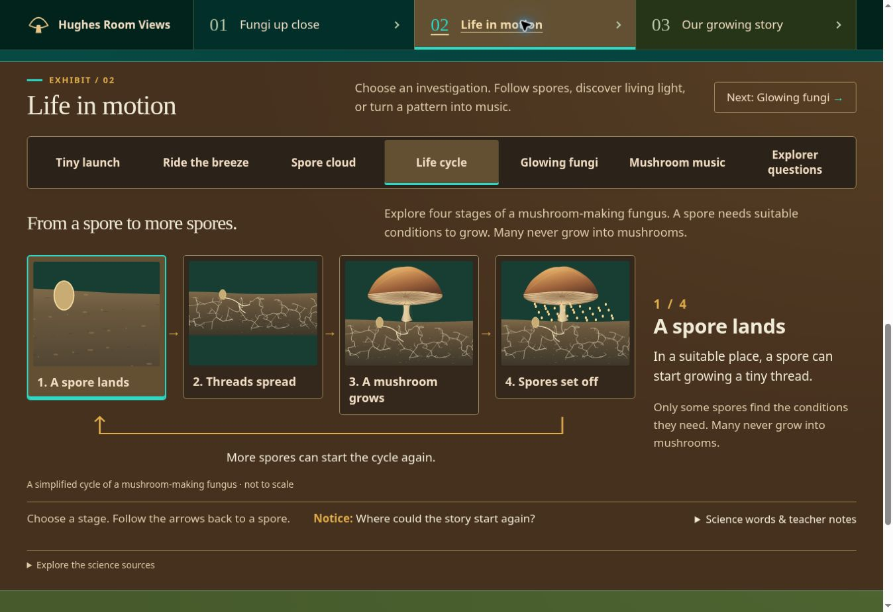
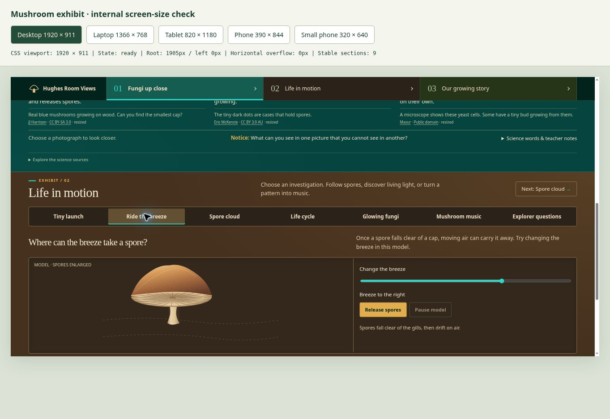

# Current checks — connected-browser acceptance, 2026-11-07

**44/46 complete. M33 passes. M41 and M46 remain open.**

The thin `review.html` entry point serves the existing source/modules/assets over HTTPS
from the already-public repository. This permits a real connected-Chrome trial, independent
of the cloud browser’s buffering and missing voices. It changes no live Edublogs route.
The exact reviewed code is remote commit `f524e3ad026b4bbb6b84f2c6805a3db4be5ba098`, tree
`ad60d02eada5d06e7483974682eee7a4da62da18`; identical to local `568d8a3`.

- **Real in-exhibit video:** first trial reached native time 8.916314 s and Pause held at
  20.825633 s. Second trial reported playing/time 9.65 in the app; native currentTime was
  10.231616 s, readyState 4, duration 235.681 s, paused false and muted false. Pause reported
  paused/time 27.44; native paused time was 27.887443 s. Changing to Glowing fungi removed
  the player. The actual moving creator footage is pictured in `qa/batch-6-video-playing.png`.
  Source/sensor/rights/artistic-choice/unknown-processing checks remain unchanged. **M33 passes.**
  These observations do not certify auditory quality or school-network availability.
- **Actual speech attempt:** six English voices appeared inside the exhibit. David, Google
  US English and Zira each emitted end before start for a 515-character lesson. The previous
  code misleadingly said finished. It now reports an error and suggests another voice or
  the complete written lesson. An end before start and an implausibly fast long-lesson end
  are refused; normal elapsed completion remains supported. DOM diagnostics capture the
  actual event outcome; no speaker configuration, permission or OS setting is changed.
  **M41 remains open:** no successful speech or actual science-word pronunciation is claimed.
- **Classroom:** no real teacher/projector/pupil observations supplied. **M46 remains open.**
- **Verification:** `npm run check:mushrooms` passes **50 tests**, syntax, generated files,
  original media integrity and standalone build. New regressions catch premature speech
  success and preserve normal long/short completion. `git diff --check` passes. Native
  review width 1905 px, root 1905 px and zero horizontal overflow; the three default photos
  loaded at 1600/720/1560 natural widths. Prior broad layout/contrast/zoom audits remain dated
  evidence below; this pass does not claim a repeated full matrix.

Current results and limits: `qa/batch-6-verification.json`. Proof: [playing real video](qa/batch-6-video-playing.png)
and [truthful speech failure](qa/batch-6-reading-failure.png). Use [REVIEW-HANDOFF.md](REVIEW-HANDOFF.md)
for the exact HTTPS review and remaining teacher observations. Source remains draft/research
pending. No kit, classroom photos, dates, entries or outcomes are invented.

---

# Historical checks — real-video resilience, 2026-11-07

**43/46 fixes complete; M33, M41 and M46 remain open.** This follow-up strengthens the
real creator-video player and supplies [REVIEW-HANDOFF.md](REVIEW-HANDOFF.md) for the
actual target-browser/teacher observations. It does not infer acceptance from unit tests.

- `npm run check:mushrooms`: **48 pass, zero fail**, plus syntax, generated schema/control
  consistency, unchanged local-media integrity and standalone build. Contract is **1.9.0**.
  The six new tests exercise provider states/clock; buffering deadlines; recoverable errors;
  retry/late-player/close/destroy ownership; actual-origin/autoplay-off URLs; singleton API
  loading, existing callback preservation, and failed/timeout/CSP cleanup with explicit retry.
- Official onReady was observed. After the visitor clicked Play, the API reported buffering
  then timeout. It remained at currentTime 0 / readyState 0. The app showed the authored
  timeout message and retry. This is an unresolved playback limitation in this browser,
  not evidence of an unavailable creator recording or a bot-detection block. **M33 is open.**
- Retry created exactly one fresh frame at time 0 and state loading. Close removed the frame,
  set state closed and returned focus to Load. Changing to Glowing fungi removed the frame.
  No automatic retries or autoplay are used. Provider events, errors and clock values are
  observed through the official API; a thumbnail/onReady does not imply playback.
- Five settled responsive layouts had zero page overflow. The iframe’s **client** sizes were
  718×403 desktop/laptop, 712×400 tablet, 291×200 phone and 229×200 small phone. These include
  the actual 200 px client-height minimum rather than counting its border. Close was 48 px
  tall across five sizes; Retry was 48 px in the timeout state. Status text was 18 px.
- Default desktop remained page 2737 px, journal y2382.95, stations 904.23/868.39 px. The
  disclosure adds space only while open. The prior broad activity/zoom/contrast evidence
  below remains dated evidence; this confined follow-up checked the expanded player at
  five sizes rather than claiming a new full-matrix/contrast audit.
- Connected Chrome showed six English choices on the official MDN speech demo. No exhibit
  audio was played there; actual voice/pronunciation acceptance remains unverified. The
  cloud browser still has zero English voices. **M41 is open.** No actual teacher, projector
  or pupil observations have been supplied, so **M46 is open**.

Evidence: `qa/batch-5-verification.json`, [player and honest ready prompt](qa/batch-5-video-feedback.png).
No classroom data, new media, dependency, immutable release, live route/Hub swap or injection
change was introduced. The preview and source remain draft/scaffold/research pending.

---

# Historical checks — reading/access batch 4, 2026-11-06

Implementation: [aefb03b4736d005da66b2ad467870af8f43ced68](https://github.com/ProfessorMinty/HughesWebAssets-Source/commit/aefb03b4736d005da66b2ad467870af8f43ced68).
Tree `768d19d3a16d677b47842e480fdc608b8e6b1182` equals local
`6a7c347697d5755efd63999dd5136fd4f548ec9e`. **43/46 fixes are complete.**
Only M33 (embedded playback), M41 (actual voice/pronunciation acceptance) and M46
(real teacher/projector/pupil trial) remain open; all are explicit acceptance gates.

## Automated and numerical checks

- `npm run check:mushrooms`: **42 tests pass**, syntax, generated contract/schema/control
  consistency, original media integrity and standalone build. Five new tests cover source-owned
  interface edits/templates, fresh selected narration text, voice capability/errors/late
  arrival, utterance lifecycle/cleanup and contrast/alpha/gradient/image-mask calculations.
- Contract **1.8.0** owns shared data.ui and editable block labels. No new dependency, third-party
  audio clip, specimen image or classroom data was introduced. `git diff --check` passes.
- **203 computed text/style cases** and **39 image-mask/overlay bounds** pass, using 4.5:1
  for normal text and 3:1 for qualifying large text. Hero bounds use actual positions at
  five sizes; photo overlays are checked against arbitrary black/white image extremes.
  The selected-instrument hover rule was fixed and its actual :hover colors verified.
- Actual visible focus samples used 3 px outlines. Conservative contrast across audited
  base/tray/selected surfaces is at least 3.73:1 for amber, 4.30:1 for cyan. States retain
  labels, weight, inset markers, underlines or named feedback. This is not WCAG certification.

## Actual browser checks

- All **55 activity/layout cases** and **15 job/layout cases** passed: no horizontal overflow,
  one active block panel per station, all visible custom controls at least 44×44 CSS px.
  Checkbox labels supply the larger clickable target. Short credit links were found and fixed.
  Browser/third-party video controls are outside this custom-target claim; large custom
  Play/Pause/Replay/Fullscreen alternatives remain.
- Actual **200% Chrome zoom** was visually confirmed. All **eleven** activities passed
  overflow/target checks at 674 px document width; keyboard Enter advanced silent music-note
  inspection. Zoom returned to 100%. Small-screen content expands rather than being clipped.
- Keyboard Enter, tab arrows/Home/End, anatomy part selection and selected/current cues were
  exercised. Dialog Escape returned focus to the image opener. Header/focused-control positions
  stayed below sticky navigation. Default first heading y137.83 versus nav bottom 77.
- Direct legacy links lab→glow and lifecycle→launch, new sound→music, and journal/back→music
  worked. Journal received focus and remained below navigation. History behavior is retained.
- Motion choice made root less-motion true and CSS transition duration 0 s; growth remained
  inspectable by steps and music kept its silent Next note while timed Play was hidden. Turning
  motion back on did not auto-resume. System changes and storage failure remain unit tested.
- Local microscope footage reached readyState 4 and played; Pause held it at 0.0505 s.
  The QA iframe initially lacked fullscreen permission; that harness omission was fixed.
  The native player then visibly filled the review surface (1363×936 versus 464.55×232.27
  after Escape). Focus correction excludes fullscreen. Original low-resolution video detail
  is unchanged. The cloud DOM bridge's element-identity equality did not report the visible
  fullscreen state, so screenshot/geometry observations are the evidence for that check.
- Optional reading correctly reported **zero English voices** and displayed a useful unavailable
  message. Reading text follows current source/selected records and excludes credits/teacher
  drawers. Injected speech tests pass; no actual audible reading or pronunciation pass is claimed.

## Remaining gates and footprint

M33 remains open: both official privacy-enhanced and standard creator players rendered in
this cloud browser but stayed at time 0 / readyState 0 after Play. Earlier creator-site
playback succeeded in the connected browser. The exhibit keeps source/device/artistic-choice
explanations, disclosed unknown processing and a direct fallback. No media are downloaded.

M41 remains open until a real available English voice is exercised and science-word speech
is checked. M46 remains open until teacher/projector/pupil feedback is supplied. These limits
do not certify physical devices, screen readers, listening quality or classroom comprehension.
Source publication/research state remains scaffold/pending; journal authoring remains deferred.

Default 1920×911: page **2736.94 px**, story **y2382.95 px**, stations **904.23/868.39 px**.
The story moved about **115 px** versus batch 3, following larger text, usable credit targets
and optional reading controls. The two-station structure and direct story shortcut remain.

Evidence: `qa/batch-4-verification.json`, `qa/batch-4-samples.json`,
`qa/batch-4-contrast.json`, [reading-station proof](qa/batch-4-reading.png).
Reproduce the captured numerical audit with:

```sh
node tools/audit-mushroom-contrast.mjs apps/mushroom-exploration/qa/batch-4-samples.json apps/mushroom-exploration/qa/batch-4-contrast.json
```

These are dated captures; use a fresh browser pass after material layout/palette changes.

---

# Historical checks — music batch 3, 2026-11-06

Implementation: [8cbfdc1666ea95ff4a1c15d356e3cee5608107eb](https://github.com/ProfessorMinty/HughesWebAssets-Source/commit/8cbfdc1666ea95ff4a1c15d356e3cee5608107eb).
Tree `24f325f4993a3a08a11002868234fde9fa591ca7` equals local implementation
`9d44f1602c531f3669fc530be90bfaf2883fbe90`. **33/46 checklist items are complete.**
M28–M32 and M34–M35 are newly checked. M33 remains open; see its exact limitation below.

`npm run check:mushrooms` passes **37 tests**, syntax, generated contract/schema consistency,
original media hashes and build. The seven additions cover shared sample/pitch/onset identity
across timbres; distinct synthesis envelopes; pause/resume/end/replay/volume; silent inspection;
unsupported/rejected/interrupted startup; stale callbacks/context interruption/destroy cleanup;
protected editable music records; and registered embed-only external media. No dependency added.
`git diff --check` passes. Contract is 1.7.0; asset catalog is 1.2.

Actual browser checks:

- All **55 activity/layout cases**, eleven choices at each of the five reference sizes,
  had no horizontal overflow and one active block panel per station. All visible music
  buttons were at least 44 px tall at every size. Phone chains follow stages 1→2→3→4 vertically.
- Play entered playing; Pause held the current sample and Resume continued. Instrument
  selection reset to zero with the same data. Replay/Stop, separate new-pattern generation,
  silent Next note, observation feedback and shared Step-by-step view were exercised.
  Correct SVG namespaces and all sixteen sample points were verified in the browser.
- Starting the example removes a loaded real-demo iframe. Explicit close removes it.
  Activity changes and chapter links stop the example; chapter-link cancellation is immediate.
  Visibility/offscreen listeners and removal cleanup are implemented. This controlled browser
  kept document.hidden false during tab-switch inspection, so hidden-tab behavior was not
  certified end to end. Transport interruption/cleanup is covered by injected-clock tests.
- Actual Chrome **200%** zoom was visibly confirmed; all seven second-station choices had
  no overflow at 674 px document width. Keyboard Enter advanced silent note inspection.
  Zoom was restored. No physical-device, screen-reader, listening-quality, projector or pupil
  trial is claimed. M41 narration remains unbuilt; its media coordination events are in place.
- Default 1920×911 footprint: page 2601.97 px; story y2267.98 px; stations 835.92/821.73 px.
  These match batch 2. The optional desktop music workbench measured 716.06 px high. Its
  height adapts to narrower widths; explanations are not clipped to force a screen height.

**M33 limitation:** The original creator-page recording played in the connected browser,
with advancing time, 235.681 s duration and readyState 4. In our cloud preview, the official
privacy-enhanced embed rendered but stayed at time 0 / readyState 0 after Play. Source,
conductivity measurement, human sound choices and embed-only permissions are documented;
raw data, exact mapping, species and playback-speed processing are unavailable and explicitly
qualified. A direct creator-page fallback remains visible. Actual in-page playback acceptance
is still pending; this is not a claim that the clip is permanently unavailable.

Proof: [music workbench](qa/batch-3-music.png). See `IMPLEMENTATION-CHECKLIST.md` batch 3 for
requirement-level evidence. M02, M33 and M36–M46 are still open, including teacher/pupil review.
Source state remains scaffold and research pending; this batch creates no classroom entries
or production release.

---

# Historical checks — process batch 2, 2026-11-06

Implementation: [f1fddbae950817a9cbcf260c9886312d9fc9e902](https://github.com/ProfessorMinty/HughesWebAssets-Source/commit/f1fddbae950817a9cbcf260c9886312d9fc9e902).
Its tree `0b230e1a5c9318d124510519948793395d808002` matches local implementation
`8d891acac702ed0c2d444b176cf062b6ce99f323`. Checklist items M16–M23, M25–M26 now have
acceptance evidence. This is 26/46 complete including batch 1; music and final checks stay open.

## Automated validation

`npm run check:mushrooms` passes **30 tests**, syntax, generated contract/schema consistency,
registered asset hashes and build. Nine additions cover finite pause/resume/end/replay with
no overlapping clock; manual/reduced-motion behavior and preference changes; connected
parent-first growth samples; breeze direction/settling; dough/pocket comparison; editable
process text with protected IDs; life-cycle ordering/crops; video error/play/pause/replay
mapping; and motion preference operation/cleanup when storage cannot be written. No dependency
was added. `git diff --check` passes. All old photo/video bytes remain unchanged.

## Actual browser checks

- All **55** first/second-station activity combinations at 1920×911, 1366×768, 820×1180,
  390×844 and 320×640 passed: selected topic agrees, one active block panel per station,
  no horizontal overflow. All four cycle buttons remain available. One initial long QA
  automation call timed out and reset its session; its partial results were discarded.
  The completed matrix was rerun in shorter calls and all 55 results were collected.
- All **15** recycling/partner/baker layout cases at the same sizes passed without overflow.
  At 320 px, new visible job controls were at least 48 px tall. Cycle buttons were each
  247×132 px in a vertical sequence with downward and return cues.
- Actual **200% browser zoom**, confirmed in Chrome: 681 px CSS viewport, all eleven activities
  selectable, no horizontal overflow. Journal heading≈207.5 px below a nav ending≈121.7 px;
  section received focus. Zoom restored to 100%. At 320 px the corresponding values were
  heading≈210.2 px / nav≈124.3 px with correct focus. This does not test independent OS text sizing.
- Growth: manual step selected below-ground view, paused at 2.667 s with 116 completed paths.
  After resume/pause it was at 2.933 s with 131 completed paths; a later read remained frozen.
  Full run later completed at 8.000 s with zero unfinished paths. Some short selector waits
  expired before the finite animations ended; subsequent state reads confirmed completion.
- Motion preference: checking Step-by-step view updated all five process toggles, hid animated
  Play and provided manual Next. Growth stepped to a stable 5.333 s view. Reload retained the
  preference. It was restored to normal playback for the remaining checks. System changes and
  unavailable storage are unit-covered; no physical OS preference was changed in this run.
- Recycling: each step changed the illustrated layer and explanation. Outside food, inside
  food at actual thread junctions, then surrounding nutrient markers were observed separately.
  The real-photo disclosure opened, its image enlarged, and the return button worked.
- Plant: sugar selection highlighted its round-marker route; water/mineral selection highlighted
  the reverse diamond-marker route with matching text. Pause held both time and marker transform;
  resume reached the finite 6.000 s ending with both directions shown.
- Dough: browser poses were scale .62 / pocket radius 2.25, scale .81 / radius 3.625, then
  scale 1 / radius 5 at 6.000 s. Leaving/returning held the risen pose. The original-size dashed
  outline stayed in the artwork. The run has no shrink/rise loop.
- Launch: the middle manual view held translate(0 0) with merged-water opacity≈.533. Ending
  held translate(-105 0), drop opacity 0 and the leader ending at the moved spore. Labels remain
  readable HTML; launch is enlarged/slowed and follows joining water. The clock does not loop.
- Wind: a current Right run was at x=550.37 / 3.000 s. After Left and resume/pause, the same
  first spore was x=532.63 / 3.267 s. After Reset in Still air, the ending showed all 36 spores
  visible at y=470. Presets supplement the slider; paused positions remain inspectable.
- Microscope video: playback had readyState 4 and advancing currentTime; pause and final Replay
  text were observed. Full screen displayed the actual video; native Escape returned to the
  page. Desktop player was about 465 px wide, versus the prior narrow comparison window.
  Its silent/extreme-slow label and English description track remain. Native load-failure/retry
  mapping is unit-tested; no live network failure was injected. The 256×128 source is enlarged
  for viewing, not upscaled with invented detail. Puffball's original playback remains recorded
  baseline evidence; this batch checked its separate context, warning, slowdown label and hashes.
- Keyboard Enter selected the recycling nutrient view and the fourth cycle explanation. Ordinary
  chapter navigation, activity choice and journal focus remained available. This is not a full
  screen-reader/keyboard certification; M39/M45 remain open for the final cross-exhibit pass.

Final default desktop journey is about **2602 px** tall, journal starts≈**2268 px**, first
station≈**836 px**, second≈**822 px**. Batch 1 was 2567/2233/836/787 px. The roughly 35 px
increase retains two compact learning rows while making the video and process controls useful.
The #06443f / #46311f / #465a2b row families remain. Final new-state contrast checks are M37.



Screenshot shows the rendered final batch layout at the browser's normal standalone width.
A final storage-failure fallback correction was unit-tested and rebuilt after capture; it does
not change that layout. A copy-only review also restored the cutaway’s explicit not-naturally-
glowing disclosure in its source-owned label. That caption edit was built/validated after the
browser matrix; the cycle screenshot and default journey are unaffected. The working preview
was updated with the final built file.

No actual classroom, projector, physical-touchscreen or screen-reader trial is claimed.
Music transport/instruments/real example, the remaining reduced-motion cursor behavior and
read-aloud stay open. Research/publication state remains pending/scaffold. Journal authoring,
Mushinator and production publication/swap remain deferred.

---

## Previous checks — checklist batch 1, 2026-11-06

Implementation: [93aee2f3c59b7b76ecbc19610230341865ebaa88](https://github.com/ProfessorMinty/HughesWebAssets-Source/commit/93aee2f3c59b7b76ecbc19610230341865ebaa88).
Tree `0cb69d7c5f882a85bb90411e9a9c0607ab8b5f0d` matches the tested local tree.
Completion by stable ID is in IMPLEMENTATION-CHECKLIST.md. This is batch verification,
not completion of the remaining diagrams/music, full accessibility certification or a pupil trial.

## Automated checks

`npm run check:mushrooms` passed 21 tests, syntax checks, generated control/schema equality,
registered asset-byte integrity and standalone build. New tests protect wind/launch film
binding, validated editable context, cited glossary/word identity, stable legacy IDs and
reserved journal, and the nine blocks the renderer requires. No dependencies were added.
Existing launch-order, finite-state inputs and physically connected parent-first network
checks still pass. `git diff --check` passed.

## Browser observations

Chrome selected all four first-station views and seven second-station activities at
1920×911, 1366×768, 820×1180, 390×844 and 320×640: **55 combinations**. Every case had
one selected/visible block panel per station and zero horizontal overflow. At smaller
widths the native labeled chooser exposes the same choices. The final roles/questions
content follow-up was rechecked at all five sizes: nine stable blocks, root x=0, no overflow,
and one visible safety rule. Breakout width was allowed to settle after each resize.

Actual browser zoom was set to **200%**, confirmed in Chrome's zoom popup. On the
1363 px browser window this produced a 681 px CSS viewport / 674 px client width.
All eleven activity choices remained selectable with zero horizontal overflow. The journal
jump focused its section with heading about 207 px down and nav bottom about 122 px.
Zoom was restored to 100%. This checks browser zoom, not independent OS text-size settings.

- Entrance Explore fungi starts at Meet the kingdom, including after free exploration.
  Header Next advances locally, focuses the destination and does not auto-advance.
  First-station final Next enters Life in motion at Tiny launch even if a different
  second-station activity was visited earlier.
- First-station Home/End and second-station End/ArrowRight selection/focus were exercised.
  Desktop destination top was about 95 px with nav bottom 77 px. At 320 px the journal
  heading was about 211 px with nav bottom 124 px. Top-level Back/Forward restored the
  proper selected view/focused section and current-location cue.
- New direct hashes wind/puffball/cycle/sound load their own topic. Legacy lifecycle loads
  launch and legacy lab loads glow. The appropriate heading and selected state were observed.
- Launch shows only the microscope film; wind shows no film; puffball shows only its own film.
  All other direct activities show no spore film. Launch playback entered readyState 4 and
  playing state; switching to wind paused and hid it. Native/custom video redesign is M23.
- Sound Play entered its expected active state; switching to glow set Sound is off and
  reenabled Play. This verifies control/cleanup state; it does not establish timbre quality
  or finish the transport/instrument requirements.
- At 320 px all three kingdom dialogs opened with `object-fit: contain`, 300 px dialog
  width within the 305 px client width, then returned focus to the correct Enlarge button.
  Gill-dialog Escape also closed and returned focus. Scientific image bytes stayed unchanged.
- Selecting Mycelium hid the static gill photograph; Gills showed it with a specific caption.
  Five existing map positions remain. Small screens use static map numbers and separate
  named part buttons, measured at least 48 px tall and 128.5 px wide at 320 px. No overlapping
  small overlay targets or continuous hotspot animation were introduced.
- Optional science-word/teacher detail is text, not dependent on audio or automatic timing.
  These authored fields and the entrance/activity copy are in contract 1.5.0; pending M42
  still includes renderer-owned model-state/control text.

Final default desktop geometry: page about **2567 px**, journal y≈**2233 px**, first
station≈**836 px**, second≈**787 px**. Earlier default was 2564/2230/835 px. Row colors
remain actual rgb(6,68,63), rgb(70,49,31), rgb(70,90,43). New state/text combinations
still require the final contrast audit in M37; this batch does not extend the earlier
bounded CSS measurements into a whole-page compliance claim.



Screenshot records the rendered batch UI before the final nonvisual required-block guard,
source-citation and unmount-style cleanup changes; those changes passed the final build/check.
No physical touchscreen, screen reader, projector or pupil trial was performed. System
reduced-motion handling in JavaScript and optional narration remain open. No real mushroom-
music demo was shipped. The source is an unpublished scaffold with research review pending.

---

## Previous checks — three row palettes, 2026-11-06

- Three full-width surfaces distinguish the destinations: primary forest teal `#06443f`
  for Fungi up close, secondary warm bark `#46311f` for Life in motion, and tertiary moss
  `#465a2b` for Our growing story. Navigation panels match those destination families.
  The secondary row's tabs, model displays, video panels, graph and questions use warm
  bark shades. Its palette change includes the workbenches, not only the outer background.
- All 16 tests, syntax checks, contract/media-integrity checks and the build passed through
  `npm run check:mushrooms`. This pass changes styles and documentation, not lesson data,
  scientific geometry, media, routes or the editor contract.
- Chrome checked seven main tabs at five CSS sizes (1920×911, 1366×768, 820×1180,
  390×844 and 320×640): 35 combinations passed. Each showed the intended panel, ready
  state, root x=0, no horizontal overflow, nine stable blocks and the correct distinct
  selected colors for the two stations.
- All seven desktop panels passed the bounded computed text check against nearest opaque
  CSS backgrounds. This excludes gradient/image contrast analysis and is not a whole-site
  accessibility certification. Body text contrast on the three bases is approximately
  8.40:1, 9.32:1 and 5.81:1. Tertiary secondary text is 5.44:1; its gold labels are 5.22:1.
- Actual desktop backgrounds were `rgb(6,68,63)`, `rgb(70,49,31)` and `rgb(70,90,43)`.
  Secondary workbenches were `rgb(52,39,27)`. The default page remains about 2564 px tall,
  with the journal around 2230 px from the top. Geometry and scrolling distance are preserved.

The exhibit remains an unpublished draft.

## Previous banner palette checks — retained history

The entrance artwork is the color reference. The representative forest, moss, cap-amber,
cyan-thread and warm-highlight colors are recorded in README.md. This pass changes styles
and documentation only; content, source identities, model geometry and media are preserved.

- Cream reading surfaces, pastel mint selection fills and violet accents are replaced by
  forest surfaces, warm highlight text, dark teal selections, amber actions and cyan markers.
  The classroom story uses moss and bark tones. Scientific photographs are not recolored.
- All 16 tests passed through `npm run check:mushrooms`; the final CSS passed the standalone
  build and whitespace check.
- Chrome checked seven main tabs at five CSS sizes: 1920×911, 1366×768, 820×1180,
  390×844 and 320×640. All 35 combinations showed the intended panel, ready state,
  root x=0, no horizontal overflow, nine stable blocks and matching dark teal selected
  controls with warm text. Measurements waited for the breakout width after resizing.
- All seven desktop panels were checked for computed text contrast against their nearest
  opaque CSS surface. The skip link was separately confirmed to use dark text on amber.
  This is a bounded CSS check, not image-background, screen-reader or accessibility certification.
- Calculated base color pairs: warm text/forest surface 10.64:1, secondary text/surface
  8.23:1, selected text/teal 6.87:1, primary action text/amber 8.18:1, amber focus/surface
  6.83:1 and cyan selection marker/teal 5.08:1. Gradients use subtle overlays on these bases.
- Desktop default page remains about 2564 px tall, journal starts around 2230 px and
  station one is about 835 px. No rows or additional scrolling were introduced.
- At 320 px the journal jump still placed its heading below the sticky navigation
  (section top about 148 px; navigation bottom about 124 px). The journal and notebook
  backgrounds are moss and bark, respectively, with warm readable text.

The exhibit remains an unpublished draft; production installation and classroom authoring
remain separate work.

## Previous palette and hierarchy checks — retained history

- `npm run check:mushrooms` passes all 16 tests, syntax checks, contract/media-integrity
  checks and the standalone build. No source data, scientific diagrams or asset bytes changed.
- Chrome checked the seven main tabs at 1920×911, 1366×768, 820×1180, 390×844 and
  320×640: 35 combinations with the requested panel visible, state ready, root x=0,
  zero horizontal overflow, nine stable content blocks and mint selected tabs in both stations.
  Viewport measurements wait for the breakout width to settle after the resize observer runs.
- At 1920×911, all three specimen titles align at the same y position. Names now lead
  each card, followed by image, explanation, caption and credit. Contained images use dark
  displays and retain `object-fit: contain`; no microscopy is cropped to fill a landscape box.
- Default page height: about 2564 px; journal begins around 2230 px. Station one default
  is about 835 px; Light & sound is about 811 px. The two-station structure is preserved.
- Measured CSS color pairs: ink/paper 11.25:1, ink/mint 9.47:1, ink/amber 7.62:1,
  dark focus/paper 6.61:1, luminous focus/forest 9.09:1. Actual keyboard focus was observed
  on light and dark tabpanels. These checks do not constitute a whole-site accessibility audit.
- Chapter links display the current section with `aria-current="location"`, a visible
  underline and stronger label. Desktop chapter tracking and a 320 px journal jump worked;
  the journal heading landed below the sticky bar. Destroy cleanup disconnects its observer
  and cancels a scheduled chapter update.
- The yeast inspection dialog loaded its full image at 320 px and stayed within the
  305 px available width (approximately x=2.5 to x=302.5). Returning to the exhibit worked.
- Sound play/stop worked. The recording's primary Play control becomes an outlined Pause
  control while playing, then returns to its primary role. Spore investigation selections
  use the same mint fill plus inset marker as the main tabs.

The page remains an unpublished draft. Physical-device, screen-reader and other-browser
validation, classroom uploads, Mushinator, immutable release and live installation remain
outside this change.

## Previous two-station checks — retained history

This edition supersedes the earlier flat/reading-rail measurements below. All nine source
blocks remain, rendered in two learning stations and the classroom story.

- Sixteen local tests cover source/edit/refusal rules, registered media integrity, launch
  phase order, parent-before-child network growth and rendered stem-base attachments. Syntax and generated
  source/control/schema checks pass through `npm run check:mushrooms`.
- Chrome UI checks exercised every main tab at 1920×911, 1366×768, 820×1180,
  390×844 and 320×640: **35 combinations**, all ready, x=0, no horizontal overflow.
  All scientific SVGs have zero text elements; their labels are HTML.
- At 1920×911, station-one defaults: family about 830 px, anatomy 834 px, cutaway 799 px,
  roles 808 px. Station-two defaults: spores 788 px, light/sound 808 px, questions 830 px.
  The 77 px sticky navigation and each selected station fit within the 911 px reference
  viewport. Expanded explanations, credits and answer feedback can grow a station.
- Default page height is about 2560 px. Classroom-story position: approximately 2220 px from page top. The prior
  reading-rail edition placed it around 6038 px down. An entrance button and sticky
  navigation link bypass both learning stations. The jump brought the entire reserved
  classroom story into view during a 1363×936 standalone-browser check.
- Keyboard End selected the last station-one tab; one tab remained in the Tab order and
  selection/tabpanel visibility matched. A direct `#mushrooms-anatomy` load revealed
  the hidden panel. Sources and nested record identities remain attached.
- Root/fungus sugar flow, pause, dough rise/pause, all selected anatomy details, connected
  network replay/pause, leftward wind/release/pause, and all four illustrated life stages
  were exercised. Selecting a life stage changed its graphic state and explanation.
- Real puffball playback loaded at 1068×600, readyState 4, duration 8.9 seconds; currentTime
  advanced to 1.0022 seconds and paused on changing the view. Autoplay and looping are off.
  The lower-resolution microscopic clip remains separately identified.
- The invented sound model started on request and stopped on changing tabs. Audio notes
  and cursor use the same AudioContext clock and eight-second mapping. Its invented-data
  disclosure remains visible. Extended ion/mapping explanation is under the disclosure.
- The uncropped photo dialog opened with a loaded original-aspect image, closed back to
  the exhibit, and a discovery answer showed its authored feedback. Photos remain real
  specimen examples, not classroom observations.

The stem-connection follow-up rechecked the 35 tab/viewport combinations above. All three
numbered chapter panels remain visible down to 320 px; the lower chapter strip is absent.
The three top links were exercised at both 1920×911 and 320×640, landing their headings
below the sticky navigation. The removed strip also leaves no reserved blank image band.

The new rendered-SVG regression failed against the previous detached drawing, then passed
with both stem anchors attached. Cutaway paths start at (346.48,229.98) and (680.64,229.64);
anatomy starts at (438,463). Specimen positions/scales also define their corresponding
anchors. The life cycle connects the early mycelium to the visible germ tube, then connects
the fruiting stem to that network. The stage-two germ tube remained visible in Chrome.

During a paused growth replay, both base strands were complete while 254 later paths
remained undrawn. Resuming kept both base strands complete. All paths share one document
animation start time; finished strands are not rewound by pause/resume. Anatomy, cutaway
and life-cycle SVGs parse successfully. Current measurements are approximate CSS pixels.

These are Chrome CSS-viewport/interaction checks, not physical-device, assistive-technology
or cross-browser certification. The journal still has no invented entries, stage or species.
The Mushinator editor, classroom uploads, immutable release and live Edublogs installation
remain outside this implementation.

## Earlier observations — retained history

# Observed draft checks — 2026-11-06

`npm run check:mushrooms` passed: syntax checks, thirteen source/edit/publication-guard tests,
generated schema/control consistency and the standalone build. No dependency install is
needed for this isolated application. Standalone preview size: 1,908,262 bytes, including the entrance illustration, six real
photographs, the research clip/poster/description, source data, models, styles and JavaScript.

## Full viewport breakout

Checked in Chrome using the internal screen-size harness. These are CSS viewport checks,
not claims about physical devices. Each viewport showed state `ready` and nine stable blocks.
The root started at x=0; its width equalled available client width, excluding the scrollbar.

| CSS viewport | Root width | Horizontal page overflow |
| --- | ---: | ---: |
| 1920 × 911 | 1905 px | 0 px |
| 1366 × 768 | 1351 px | 0 px |
| 820 × 1180 | 805 px | 0 px |
| 390 × 844 | 375 px | 0 px |
| 320 × 640 | 305 px | 0 px |

An additional descendant-bounds check at 320 px found no exhibit element outside the
available document width. The standalone page was also inspected outside the harness:
edge-to-edge root, no review toolbar by default, no horizontal overflow.

## Interactive observations

- Selecting Gills changed the observation text/pressed state and faded the cap to reveal
  the gill model. All five observation controls are keyboard-operable buttons.
- Grow the threads switched to Below the surface and ran the finite SVG branch drawing.
- Release spores created 36 model particles. Their positions advanced from the gills;
  Pause model stopped the run. Moving the slider to its left endpoint changed the output
  to “Breeze to the left · 100%”.
- The earlier cartoon light switch was exercised in the first scaffold; it has now been
  retired in favour of the real glowing-fungus photograph.
- Play model sound showed its playing state; Stop sound restored the off state. Scrolling
  to a discovery answer while the sound was playing also restored the off state. This
  checks application control state and cleanup, not a calibrated audio measurement.
- Both choices in the safety question produced appropriate explanatory feedback.
- Application-filtered warning/error logs were empty during inspection. Browser-extension
  metadata errors were present under a chrome-extension URL and are separate from this app.

The draft has not been installed in live Edublogs or tested against the exact live DOM,
on Safari/Firefox, or with a screen reader. The preview uses an Amadeus-like ancestor
simulation. Publication, actual classroom content and the Mushinator editor remain later work.

## Real photograph edition — 2026-11-06

Ten local tests now pass, including registered-asset URL refusal, editable photo captions,
provenance catalog consistency, WebP signatures and delivery SHA-256 checks. The build
independently verifies the byte count and SHA-256 of every embedded photograph.

The same five CSS viewport checks above passed again with nine sections and zero horizontal
overflow. At 320 px, the open photo dialog stayed inside the available 305 px width
(left 4 px, right 302 px). Escape closed it; a subsequent descendant-bounds check found
no exhibit element outside the viewport.

All six photo buttons opened their inspection dialogs and returned to the exhibit. Chrome
reported complete image loads with natural sizes 1600×1084, 720×540, 1560×1560, 1200×1600,
1600×1200 and 1200×800 respectively. The gallery uses real photos in place of the first
three specimen icons, with additional gill, mycelium and glowing-fungus views. The full
viewer retains original aspect ratios; microscopy is labelled. Photo creators and licence
links remain available on each figure and in its dialog. Application-filtered warning/error
logs were empty during this pass.

Current self-contained photo-preview size: 1,780,675 bytes. It embeds all six image files.
The initial scaffold used eight tests and a 466,003-byte preview; its source remains in Git
history. This photo edition is the current draft. Live Edublogs remains untested/unchanged.

## Diagram and width audit — current edition

See DIAGRAM-AUDIT.md for findings, resolutions and the before/after section measurements.
The current default desktop height is 6461 px, versus 11125 px before the audit.
The current thirteen-test suite supersedes the earlier eight- and ten-test counts.
The spore station has two model views and a real 5.35-second research clip. Its native
metadata loaded without error; playback started and advanced, then paused on leaving view.
At the smallest viewport, the retained wind controls and new life-cycle step selector
worked. The final five-size breakout check again showed no horizontal overflow.
